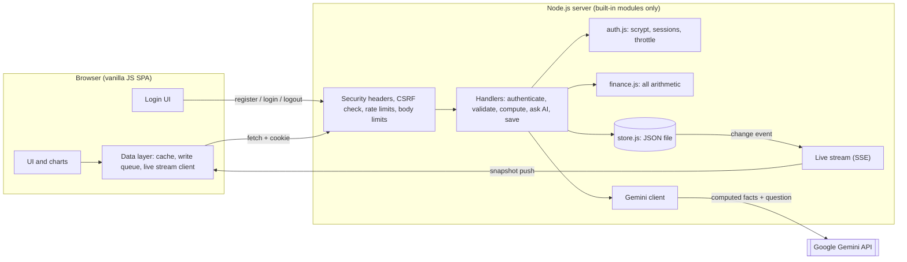
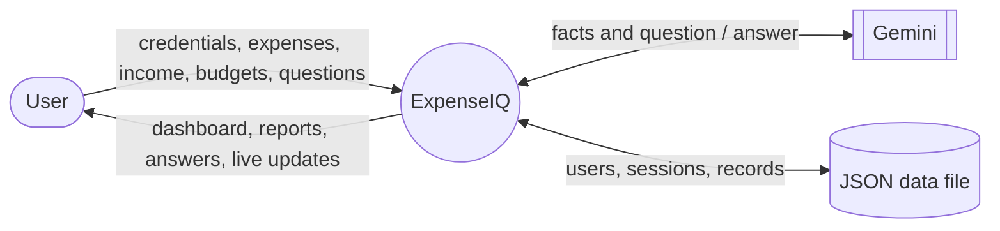
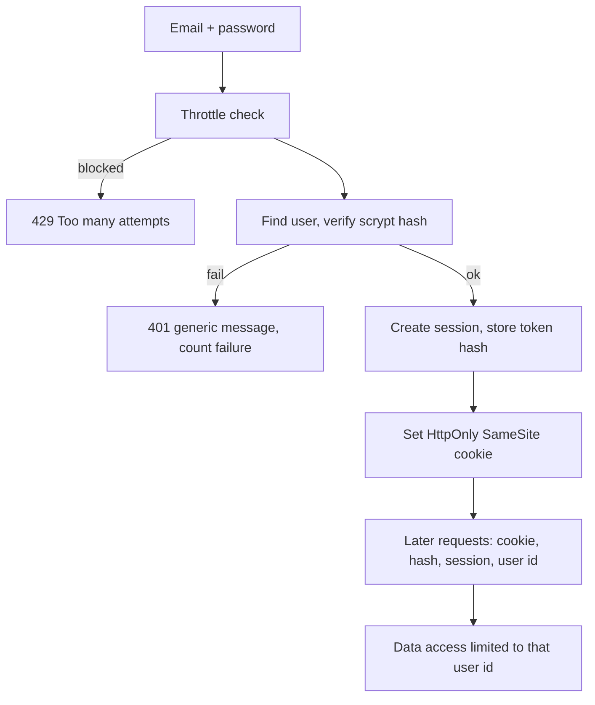
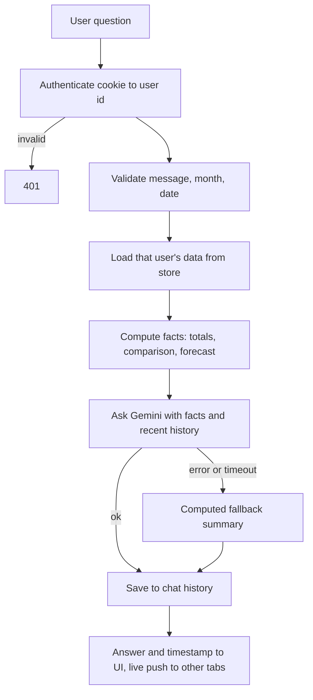
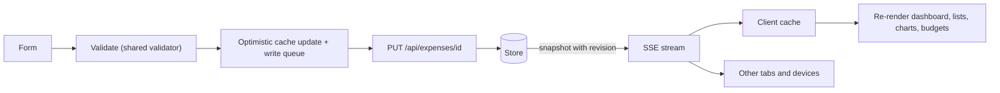

# ExpenseIQ — Expense Tracker with Custom Authentication, Live Synchronisation and an AI Assistant
### Final-Year Major Project Report

*(Add your name, roll number, guide, department and institution on the title page.)*

---

## 1. Abstract

ExpenseIQ is a web application that lets users record income and expenses, set monthly budgets, and understand their spending through charts, reports and a conversational AI assistant. It extends a single-user, browser-only tracker (HTML/CSS/JavaScript with localStorage) into a multi-user, full-stack system. The project implements its **own authentication** — registration, login and logout written from scratch using salted scrypt password hashing and server-side sessions delivered in HttpOnly cookies — without any third-party identity service. Each user's data is stored privately on the server, and every change is pushed instantly to all of that user's open tabs and devices using Server-Sent Events. A Node.js backend connects authenticated users to the Google Gemini language model. A key design principle is that the language model never performs arithmetic: totals, comparisons and forecasts are computed by tested backend code and supplied to the model as facts. The whole backend uses only Node.js built-in modules, so the project has no third-party runtime dependencies.

**Keywords:** expense tracking, custom authentication, scrypt, session cookies, Server-Sent Events, real-time synchronisation, Gemini, Node.js.

---

## 2. Problem Statement and Objectives

### 2.1 Problem statement
People often do not know where their money goes. Spreadsheets are tedious, and simple apps that store data only in the browser are tied to one device, lose data when the browser is cleared, have no login and give no guidance. Users want to *ask* questions ("Why did I spend more this month?") and receive trustworthy answers.

### 2.2 Objectives
1. Implement secure registration, login and logout without relying on external authentication services.
2. Store each user's data privately and prevent any user from accessing another's.
3. Reflect every change immediately on all screens and across devices without a page refresh.
4. Visualise spending (dashboard, category charts, trends, reports).
5. Provide an AI assistant that answers questions about the user's own finances using backend-calculated figures.
6. Preserve all original features (budgets, charts, reports, CSV import/export) and migrate existing local data without duplicates.
7. Protect passwords, sessions and personal financial data (hashing, cookie flags, CSRF checks, rate limiting, validation, safe logging).
8. Provide automated tests, documentation and a simple deployment path.

---

## 3. Existing System and Proposed System

### 3.1 Existing system (original ExpenseIQ)
| Aspect | Existing |
|---|---|
| Storage | Browser localStorage only |
| Users | Single, anonymous |
| Devices | One browser; no sync |
| Insights | Charts and statistics only |
| Income / balance | Not tracked |
| Defects found during analysis | CSV import regex produced phantom empty fields so columns shifted; dates computed in UTC so "today" was wrong before 05:30 IST; user text inserted into HTML without escaping (XSS); float expense ids embedded in inline `onclick`; sample data silently seeded |

### 3.2 Proposed system
| Aspect | Proposed |
|---|---|
| Authentication | Custom: scrypt-hashed passwords, random session tokens, HttpOnly SameSite cookie, server-side sessions |
| Storage | Server-side JSON file with atomic writes, data separated per user; localStorage only as a one-time migration source |
| Devices | Any; live updates through Server-Sent Events; offline write queue |
| Insights | Charts, reports and a Gemini assistant (Q&A, comparison, saving advice, forecast) |
| Income / balance | Tracked; dashboard shows income, expenses, balance |
| Fixes | All defects above fixed and covered by regression tests |

---

## 4. Requirements

### 4.1 Functional requirements
| ID | Requirement |
|---|---|
| FR1 | Register, log in and log out |
| FR2 | Create, view, edit, delete expenses |
| FR3 | Create, view, edit, delete income entries |
| FR4 | Set/update a monthly budget; show progress and over-budget warning |
| FR5 | Dashboard: income, expenses, balance, budget, remaining, average per active day, charts, recent items |
| FR6 | Search; filter by category, month, date range; sort |
| FR7 | Reports: monthly trend vs budget, top spending days, statistics |
| FR8 | CSV export/import; budget JSON export; clear all data |
| FR9 | AI assistant: answer natural-language questions, keep history, clear history |
| FR10 | Live update on add/edit/delete/budget change, including from another device |
| FR11 | One-time, duplicate-free migration of legacy localStorage data |
| FR12 | Clear messages for empty data, insufficient history, offline state, expired session and AI failure |

### 4.2 Non-functional requirements
| Category | Requirement |
|---|---|
| Security | Hashed passwords; HttpOnly/SameSite cookies; CSRF defence; login throttling; per-user isolation; CSP; input validation; no secrets or financial data in logs |
| Reliability | Atomic file writes; graceful degradation when AI is unavailable; offline queue with automatic resend |
| Performance | Updates visible without reload; AI call timeout 20 s |
| Usability | Responsive layout (phone to desktop), keyboard accessible, ARIA labels, notifications |
| Maintainability | Pure, unit-tested business logic; framework-independent handlers; zero third-party dependencies |
| Portability | Runs on Node ≥ 20.12 on any host; no build step |

---

## 5. System Architecture



**Layers**
1. **Presentation** — `public/`: screens, charts (Chart.js), forms, chat window.
2. **Client data layer** — `public/js/data.js`: in-memory cache fed by the initial load and the live stream; optimistic writes through an ordered queue; revision numbers discard stale snapshots.
3. **API** — `server/app.js` (HTTP, headers, limits) and `server/handlers.js` (logic).
4. **Security** — `server/auth.js`: password hashing, session tokens, cookies, login throttle.
5. **Domain logic** — `server/finance.js`: totals, category ranking, month comparison, forecast, projection.
6. **Persistence** — `server/store.js`: JSON file, atomic write-then-rename, serialised writes, per-user data.
7. **External service** — Gemini, called only from the server.

---

## 6. Authentication Design (hand-written)

| Step | What happens |
|---|---|
| Register | Validate email and password (≥ 8 chars) → normalise email → hash password with **scrypt** (N = 16384, random 16-byte salt) → store `scrypt$N$salt$hash` → create session |
| Login | Check throttle → look up user → verify password in constant time (a dummy hash is checked for unknown emails so timing does not reveal which emails exist) → create session. Wrong email and wrong password return the same message |
| Session | 256-bit random token → sent as cookie `sid` (**HttpOnly**, **SameSite=Strict**, **Secure** in production, 7-day life). The server stores only the **SHA-256 hash** of the token, so a stolen data file cannot be used to log in |
| Every request | Cookie → hash → session lookup → user id. The user id is **never** read from the request body or URL |
| Logout | The session record is deleted on the server, so the cookie stops working immediately (even if copied) |
| Brute force | 5 failures per IP+email and 10 per email within 15 minutes lock further attempts; auth endpoints are also rate-limited |
| CSRF | SameSite=Strict + required header `X-Requested-With: ExpenseIQ` + same-origin check on all non-GET requests |

Scope note: no external identity provider or library is used. "Forgot password" by email is not provided because it would require an email service.

---

## 7. Database Design (`data/expenseiq-data.json`)

```
users     { uid: { id, email, name, passHash, createdAt } }
emails    { email: uid }                              (uniqueness index)
sessions  { sha256(token): { uid, expires } }
data
 └─ uid
     ├─ expenses { id: { date, category, amount, description, createdAt, updatedAt? } }
     ├─ income   { id: { date, category, amount, description, createdAt, updatedAt? } }
     ├─ budgets  { "YYYY-MM": amount }
     ├─ chat     [ { role, text, ts, degraded? } ]   (last 200)
     ├─ meta     { legacyMigration: { at, imported } }
     └─ rev      (revision counter for live updates)
```

| Design decision | Reason |
|---|---|
| Everything under `data[uid]` | Every store method takes the uid and touches only that branch → isolation by construction |
| Client-generated record ids; PUT = upsert | Retries after a network failure cannot create duplicates; offline queueing is safe |
| Deterministic ids for CSV (`csv_<hash>`) and migration (`m_<legacyId>`) | Re-importing or two tabs importing cannot duplicate |
| Atomic write (temp file + rename), serialised queue | A crash mid-write cannot corrupt the file; concurrent requests never interleave |
| Corrupt file → refuse to start | The server never overwrites data it cannot read |
| File mode 0600, `data/` git-ignored | Data is private to the server account |

---

## 8. Use Cases

| UC | Name | Main flow | Alternate / error |
|---|---|---|---|
| UC1 | Register | Enter name, email, password → account created → signed in | Invalid email / short password / email already used → clear message |
| UC2 | Login | Enter email and password → session cookie set → dashboard | Wrong credentials → generic message; too many attempts → wait message |
| UC3 | Logout | Click Sign out → server deletes session → login screen | Network error → stays signed in with an error message |
| UC4 | Add expense / income | Fill form → validated → shown instantly → saved on server → other devices update | Invalid field → inline error, nothing saved |
| UC5 | Edit / delete | Edit dialog or confirm delete → all views update | Item deleted elsewhere → message |
| UC6 | Set budget | Choose month + amount → progress bars update | Invalid amount → error |
| UC7 | Filter and search | Category, month, date range, text | No results → empty state |
| UC8 | Import / export CSV | Choose file → parse → skip duplicates → add rows | Bad rows reported; invalid file → error |
| UC9 | Ask AI assistant | Type question → server identifies user, loads data, computes figures, asks Gemini → answer with timestamp, saved | Gemini down → computed summary + notice; insufficient data → says what is missing |
| UC10 | Live sync | Change on device A → server pushes snapshot → device B updates | Offline → banner; queued changes sent on reconnect |
| UC11 | Migrate legacy data | First login with old local data → confirm → idempotent import | Skip → never asked again |
| UC12 | Session expiry | Session removed/expired → next request returns 401 → login screen | — |

---

## 9. Data-Flow Diagrams

### 9.1 Level 0 (context)


### 9.2 Level 1 — login and access


### 9.3 Level 1 — AI question


### 9.4 Level 1 — real-time CRUD


---

## 10. Implementation Notes

- **Forecast** (`forecastNextMonth`): uses up to six *complete* previous months with expenses; needs ≥ 2. Two months → average; three or more → 50 % average + 50 % linear-trend value (clamped ≥ 0). Returns range, months used and confidence; otherwise explains that data is insufficient. The current month is projected separately, pro-rata.
- **Time zones:** the browser sends its *local* month/date, so users in India see the correct "this month" even when the server runs in UTC.
- **Optimistic writes with a queue:** changes appear instantly; the queue is sent in order; network failures pause and retry; a server rejection drops that change, rolls the view back and shows an error; a 401 returns the user to the login screen.
- **Revision numbers:** every change increments `rev`; the client ignores snapshots older than what it already has.
- **CSV duplicates:** a multiset comparison of `(date, category, amount, description)` against existing rows decides what is new; new rows get deterministic ids; the server import is idempotent.
- **AI prompt safety:** the system prompt forbids recalculation, requires "insufficient data" statements, treats descriptions as data (not instructions) and limits scope to personal finance.
- **Logging:** only error codes are logged — never passwords, message text, e-mail addresses or amounts (verified by a test).

---

## 11. Testing

### 11.1 Strategy
| Level | Tool | Scope |
|---|---|---|
| Unit | `node:test` | finance maths, Gemini client, auth primitives, file store, CSV/validation helpers, config |
| API logic | `node:test` | registration, login, logout, validation, isolation, import, migration, AI failure handling, log hygiene |
| Integration | `node:test` over real HTTP | cookies, CSRF, headers, static-file safety, size limits, rate limits, live stream, restart persistence |
| End-to-end | Playwright + Chromium | full UI flows with two "devices" against the real server |

### 11.2 Results obtained during development
| Suite | Result |
|---|---|
| Unit + API + integration (`npm test`) | **92 / 92 passed** |
| Browser e2e (`npm run test:e2e`) | **25 / 25 passed** |
| Live Gemini | **Not executed** (no API key or network access in the development sandbox) — see §13 |

The e2e suite stubs only two things: the Gemini call, and Chart.js (a CDN script) — so chart *drawing* is not covered by automated tests; check charts visually.

Defects found and fixed by testing: CSV column shift (original bug), UTC date bug, XSS via descriptions, mobile layout overflow from a long unbroken description (fixed with `min-width: 0` on the flex chain), and an empty-name cookie being accepted by the cookie parser.

### 11.3 Representative test cases
| TC | Scenario | Expected | Level |
|---|---|---|---|
| T01 | Register with invalid email / short password / existing email | 400 / 400 / 409 with clear message | API + e2e |
| T02 | Wrong password vs unknown email | Identical message (no account enumeration) | API |
| T03 | 5 wrong passwords then correct password | 429 until window passes | API + HTTP |
| T04 | Password in data file | Only a scrypt hash is stored; raw session token not on disk | store + HTTP |
| T05 | Cookie flags | HttpOnly, SameSite=Strict, Secure in production; JS cannot read it | HTTP + e2e |
| T06 | Logout then replay old cookie | 401 | API + HTTP + e2e |
| T07 | Forged / tampered / expired cookie | 401 | API + HTTP |
| T08 | POST without CSRF header / with foreign Origin | 403 | HTTP |
| T09 | Add, edit, delete expense | Dashboard updates without reload | e2e |
| T10 | Invalid amount, date 31-Feb, empty description, unknown category | Rejected; nothing stored | API + e2e |
| T11 | `` in description | Shown as text; script never runs | e2e |
| T12 | Second device adds/deletes | First device updates automatically | HTTP + e2e |
| T13 | Go offline, add expense, come back | Shown instantly, queued, delivered after reconnect | e2e |
| T14 | Server restart | Users, data, chat, sessions preserved | HTTP |
| T15 | CSV with quoted comma | Columns stay aligned | unit + e2e |
| T16 | Re-import same file / own export | 0 added, duplicates reported | unit + e2e |
| T17 | AI question | Reply uses backend-computed totals; saved; shown live | API + e2e |
| T18 | Gemini timeout / 429 / empty | 200 with computed summary + notice; no internals leaked | API |
| T19 | User B asks AI / reads data / deletes A's id | Only B's data used; A unaffected | API + HTTP + e2e |
| T20 | Path traversal (`/../server/app.js`, `%2e%2e`, dotfiles) | 404 | HTTP |
| T21 | Oversized or malformed body, wrong content type | 413 / 400 / 415 | HTTP |
| T22 | Session removed while app open | Returns to login screen, data cleared | e2e |
| T23 | Legacy localStorage migration | Offered once; second run refused; existing budget kept | API + e2e |
| T24 | Phone viewport 375 px | No horizontal overflow | e2e |
| T25 | Corrupt data file | Server refuses to start and does not overwrite | store |

---

## 12. Limitations and Future Scope

**Limitations**
- Storage is a single JSON file — suitable for a project or a small group, not thousands of users; one server instance only.
- No "forgot password" e-mail (needs an e-mail service).
- Login throttle and rate limits are held in memory and reset on restart.
- Offline changes are queued only while the tab stays open.
- Single currency (INR). Forecast is statistical, not machine learning.
- AI quality depends on Gemini availability and quota.

**Future scope:** SQL/NoSQL database, password reset by e-mail, two-factor login, "log out everywhere", recurring expenses, receipt OCR, multi-currency, shared budgets, notifications, installable PWA, streaming AI answers, CI pipeline.

---

## 13. Installation, Execution and Live Verification

See `README.md`. In short: install Node.js 20.12+, run `npm start`, open `http://localhost:3000`.

**One-time live verification checklist (≈10 minutes, before your demo):**
1. `npm start`; open `http://localhost:3000/api/health` → `status: ok`.
2. Register account A in one browser and account B in another (or a private window).
3. A adds expenses, income and a budget → dashboard updates instantly.
4. Open A in a second tab: change an expense → the first tab updates by itself.
5. Check `data/expenseiq-data.json`: passwords appear only as `scrypt$…` hashes.
6. Add `GEMINI_API_KEY` to `.env`, restart, ask the six sample questions as A; compare numbers with the dashboard.
7. As B, confirm none of A's data appears and the assistant answers from B's (empty) data.
8. Stop the server, add an expense in the open page (it appears immediately), restart the server → it is delivered.
9. Click Sign out; press the browser Back button → still signed out.
10. Remove the Gemini key and restart → the assistant still replies with the ⚠️ computed summary.

---

## 14. Demonstration Script (≈8 minutes)

1. **Intro (30 s):** problem, and what changed from the old localStorage app.
2. **Login system (1 min 15 s):** register, show validation, log out, wrong password message; show the data file with hashed password only.
3. **Real-time (2 min):** two windows side by side; add/edit/delete in one, watch the other.
4. **Budget and charts (1 min):** set a budget, progress bar, over-budget warning, reports.
5. **AI assistant (2 min):** ask the six questions; numbers match the dashboard because the backend computed them.
6. **Security (1 min):** second account is isolated; show cookie flags in browser dev tools (HttpOnly); mention CSRF and throttling.
7. **Resilience (30 s):** stop the server / go offline and add an expense; it syncs when back.
8. **Tests (30 s):** run `npm test`.

---

## 15. Viva Questions (with short answers)

1. **How does your login work without Firebase or any library?** The server hashes the password with scrypt and a random salt, stores the hash, and after a correct login creates a random session token that is sent as an HttpOnly cookie.
2. **Why scrypt, not SHA-256 or MD5?** Those are fast, so attackers can try billions of guesses; scrypt is deliberately slow and memory-hard, and the per-user salt prevents rainbow tables.
3. **What is stored about the session?** Only the SHA-256 hash of the token with the user id and expiry; if the file leaks, the tokens cannot be reconstructed.
4. **What does HttpOnly do? SameSite? Secure?** HttpOnly hides the cookie from JavaScript (limits XSS damage); SameSite=Strict stops the browser sending it on cross-site requests (CSRF); Secure sends it only over HTTPS.
5. **How is CSRF prevented?** SameSite=Strict, a required custom header that cross-site forms cannot set, and a same-origin check.
6. **How do you stop brute-force attacks?** Failed-login throttling per IP+email and per email, plus rate limits on the auth endpoints.
7. **Why return the same error for unknown email and wrong password?** So attackers cannot discover which emails are registered; timing is equalised by hashing a dummy password.
8. **How is user data isolated?** The user id comes only from the server-side session; every store function takes that id and touches only that user's branch.
9. **How does real-time sync work without Firebase?** The browser opens a Server-Sent Events connection; whenever the store changes, the server pushes the user's latest snapshot with a revision number to all their open connections.
10. **What if the network drops?** Changes show immediately, are queued, and are re-sent in order when the connection returns; ids are chosen by the client so a retry cannot duplicate.
11. **Why not call Gemini from the browser?** The API key would be exposed; the server also computes the numbers and limits the data sent.
12. **Why does the backend compute totals rather than the AI?** Language models can make arithmetic errors; deterministic code is testable and explainable.
13. **What if Gemini is down?** The server returns a computed summary with a visible notice.
14. **How do you prevent duplicate imports?** Deterministic ids plus comparison with existing rows; the import endpoint is an idempotent upsert.
15. **How is the data file protected from corruption?** Writes go to a temporary file then are renamed atomically, writes are serialised, and a corrupt file is never overwritten.
16. **How is XSS prevented?** All user text is escaped before display and the Content-Security-Policy forbids inline scripts.
17. **What bugs did you find in the original?** CSV regex phantom fields, UTC date bug, unescaped HTML, float ids in inline handlers.
18. **What are the limits of your design and how would you scale it?** Single JSON file and single instance; move to a real database, share sessions/rate limits in a store like Redis, and add password reset by e-mail.
